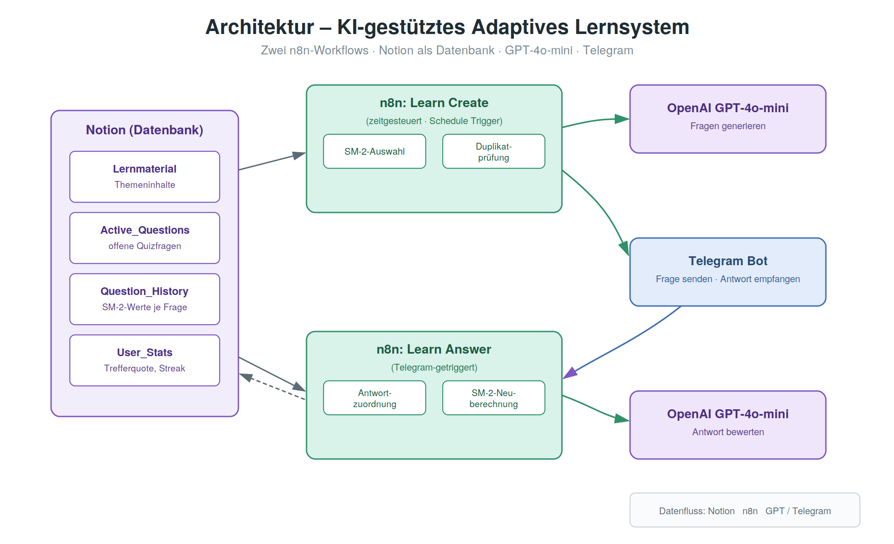
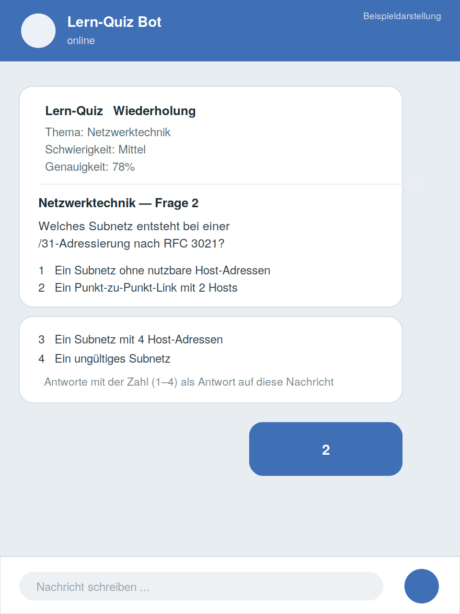
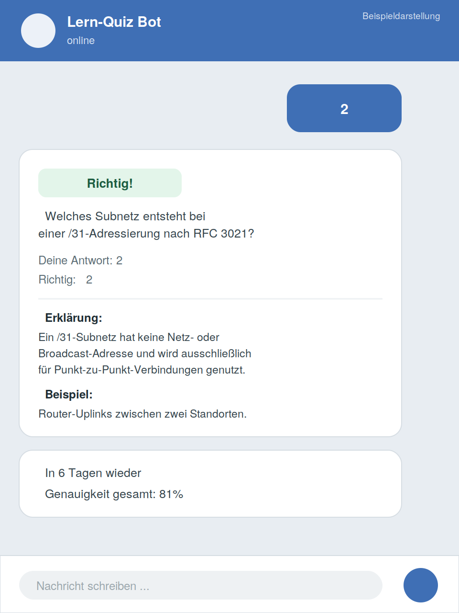

# 🧠 KI-gestütztes Adaptives Lernsystem

Ein Telegram-Bot zur automatisierten Wissensabfrage mit KI-generierten Quizfragen,
gekoppelt an Notion als Datenbank und einem Spaced-Repetition-Algorithmus (SM-2)
zur individuell angepassten Wiederholungsplanung.

> Privates Lernprojekt | n8n (self-hosted), Notion, OpenAI GPT-4o-mini, Telegram

Ausgelegt für einen Nutzer: Fragen und Feedback gehen an einen Telegram-Chat,
die Statistik aktualisiert den ersten Eintrag in User_Stats.

## 📌 Motivation

Beim Lernen für Prüfungen (IHK, Abitur, Studium) reicht reines Lesen von
Unterlagen oft nicht aus – aktives Abfragen zum richtigen Zeitpunkt verbessert
die Merkfähigkeit deutlich (Spaced Repetition). Ziel war ein System, das:

- eigenes Lernmaterial automatisch in Quizfragen umwandelt
- fällige Themen zuerst auswählt, das Intervall dazu liegt pro Thema
- ganz ohne zusätzliche App nutzbar ist – direkt über Telegram

## 🏗️ Architektur



Zwei n8n-Workflows, verbunden über eine gemeinsame Notion-Datenbankstruktur:

**1. Learn Create** *(zeitgesteuert)*

```
Schedule Trigger → Lernmaterial + Verlauf aus Notion laden
→ SM-2-Auswahl (fällige Themen zuerst, danach neue, Rest auffüllen)
→ GPT-4o-mini generiert Quizfragen
→ Versand per Telegram → Speicherung in Notion
```

Doppelte Fragen filtert der Workflow nur grob. Im Prompt stehen bis zu 30
vorhandene Fragetexte mit dem Hinweis, sie nicht zu wiederholen. Danach wirft
`Parse Alle Fragen` Treffer raus, deren Text schon als Titel in Active_Questions
steht oder in diesem Lauf schon übernommen wurde (Vergleich kleingeschrieben
und getrimmt). Dasselbe gilt, wenn die ersten 50 Zeichen mit so einem Text
übereinstimmen. Eine andere Formulierung bleibt drin.

```javascript
  let dup = existingTexts.has(ql) || seen.has(ql);
  if (!dup) { const p = ql.substring(0,50); for (const e of existingTexts) { if (e.substring(0,50)===p) { dup=true; break; } } }
  if (dup) continue;
```

**2. Learn Answer** *(Telegram-getriggert)*

```
Telegram Reply → Zuordnung zur offenen Frage
→ GPT-4o-mini bewertet die Antwort inhaltlich
→ SM-2 für das Thema (Ease-Factor, Intervall, nächstes Fälligkeitsdatum an der page_id)
→ Statistik-Update (Trefferquote, Streak)
→ Feedback mit Erklärung per Telegram
```

**Notion-Datenbanken:** `Lernmaterial` · `Active_Questions` · `Question_History` · `User_Stats`

## 🤖 Warum SM-2 (SuperMemo-2)?

Die SM-2-Werte stehen pro Thema in Question_History, nicht pro Frage. Learn Answer
nimmt die erste Zeile mit der page_id des Lernmaterials und schreibt dort
Ease-Factor, Intervall, Wiederholungen, times_correct und times_incorrect.

- Richtig: Intervall wird 1, bei der zweiten richtigen Antwort 6, danach auf ganze Tage gerundet mal Ease-Factor
- Falsch: Wiederholungen und Intervall werden 0. next_due liegt trotzdem mindestens einen Tag später. Der Selector behandelt Intervall 0 wie ein neues Thema, nicht als fällige Wiederholung
- Der Ease-Factor wird mit der quality-Bewertung (0 bis 5) nachgezogen und bleibt mindestens 1,3

Welche Themen der nächste Lauf nimmt, steht bei der Fragenauswahl: fällige zuerst,
freie Plätze werden aufgefüllt.

## 💻 SM-2-Berechnung (Auszug)

```javascript
// 3. History per page_id suchen
let historyId = '';
let h = null;
try {
  const historyItems = $('Get Question History').all();
  for (const item of historyItems) {
    const pid = (item.json.property_page_id || item.json.page_id || '').toString().trim();
    if (pid && pid === match.page_id) {
      historyId = item.json.id;
      h = item.json;
      break;
    }
  }
} catch(e) {
  // History nicht geladen? Kein Problem, erstellen wir neu
}

// 4. SM-2 Berechnung
let ef = h ? (parseFloat(gp(h, 'ease_factor')) || 2.5) : 2.5;
let interval = h ? (parseInt(gp(h, 'interval')) || 0) : 0;
let reps = h ? (parseInt(gp(h, 'repetitions')) || 0) : 0;
let tc = h ? (parseInt(gp(h, 'times_correct')) || 0) : 0;
let ti = h ? (parseInt(gp(h, 'times_incorrect')) || 0) : 0;

if (isCorrect) {
  tc++; reps++;
  if (reps === 1) interval = 1;
  else if (reps === 2) interval = 6;
  else interval = Math.round(interval * ef);
} else {
  ti++; reps = 0; interval = 0;
}

ef = ef + (0.1 - (5 - quality) * (0.08 + (5 - quality) * 0.02));
if (ef < 1.3) ef = 1.3;
ef = Math.round(ef * 100) / 100;
```

Der Helfer `gp` steht im Workflow zwischen den beiden Blöcken und ist hier weggelassen.

*Vollständige Logik in [`workflows/Learn_Answer.json`](workflows/Learn_Answer.json)*

## 🧩 Adaptive Fragenauswahl

Die "SR Selector + Adaptive"-Logik in **Learn Create** entscheidet bei jedem Lauf:

- Welche Themen sind laut SM-2 fällig? Intervall größer 0 und next_due erreicht
- Welche Themen neu sind (keine History oder Intervall 0)
- Ob bis 10 Themen aufgefüllt wird, auch mit noch nicht fälligen. Pro Thema 3 Fragen

Die Schwierigkeitsstufe für die Generierung kommt aus dem Lernmaterial, sonst "Leicht".

## Noch offen

Die Stufe nach 3 richtigen Antworten in Folge hoch und nach 2 falschen runter
zu setzen, ist noch nicht umgesetzt. Der Selector prüft `consecutive_correct`
ab 3 und `consecutive_incorrect` ab 2, schreibt beide Felder aber nie in die
Question_History. Der neue Schwierigkeitsgrad wird auch nicht ins Lernmaterial
zurückgeschrieben.

Für den aktuellen Lauf kann die Stufe des Themas aus times_correct und
times_incorrect abweichen: ab 5 Antworten eine Stufe hoch bei mehr als 80 %,
eine Stufe runter bei weniger als 40 %. Dieser Wert steht dann auf der Frage.
Der nächste Lauf liest die Stufe wieder aus dem Lernmaterial.

## ✅ Antwortbewertung per KI (statt stumpfem String-Vergleich)

Die Bewertung nutzt GPT-4o-mini als "IT-Ausbilder"-Persona, die die Antwort
inhaltlich einordnet (`quality`-Skala 0–5, analog zum klassischen SM-2-Modell),
statt nur exakte Übereinstimmung zu prüfen – inklusive kurzer Erklärung und
Praxisbeispiel als Feedback.

## 💬 Prompt-Beispiel (Fragengenerierung)

```
Generiere ein JSON-Array mit EXAKT {total_questions_expected} Quizfragen.
Für JEDES Thema GENAU {questions_per_page} Fragen.

Format — NUR dieses JSON-Array:
[{"page_id":"...","subject":"...","question":"...",
  "options":["A","B","C","D"],"correct_answer":"A",
  "explanation":"2-3 Sätze Erklärung."}]

Schwierigkeit: Leicht=Definitionen, Mittel=Anwendung,
Schwer=Szenarien, Experte=Grenzfälle

WICHTIG: Keine Duplikate · Nur Infos aus dem Lernmaterial · Nur JSON-Array
```

## 🖼️ Screenshots

| | |
|---|---|
|  Quiz-Frage per Telegram |  Auswertung mit Erklärung |

## 🛠️ Tech Stack

`n8n (self-hosted)` `Notion API` `OpenAI GPT-4o-mini` `Telegram Bot API`
`JavaScript (Code Nodes)` `SM-2 Spaced-Repetition-Algorithmus`

## 📁 Repo-Struktur

- [`diagrams/`](diagrams/) → Architektur-Übersicht
- [`screenshots/`](screenshots/) → Bot in Aktion (Quiz & Feedback)
- [`workflows/Learn_Create.json`](workflows/Learn_Create.json) → n8n-Workflow: Fragengenerierung & Versand
- [`workflows/Learn_Answer.json`](workflows/Learn_Answer.json) → n8n-Workflow: Auswertung & SM-2-Berechnung

---

*Aus Datenschutzgründen wurden Telegram-Chat-ID, Notion-Datenbank-IDs,
Zugangsdaten-Referenzen und die n8n-Instanz-ID aus den Workflow-Dateien
entfernt bzw. anonymisiert.*
